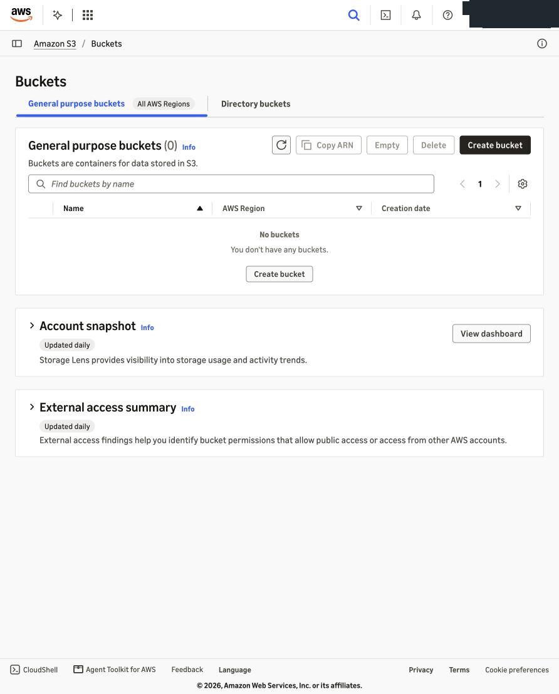
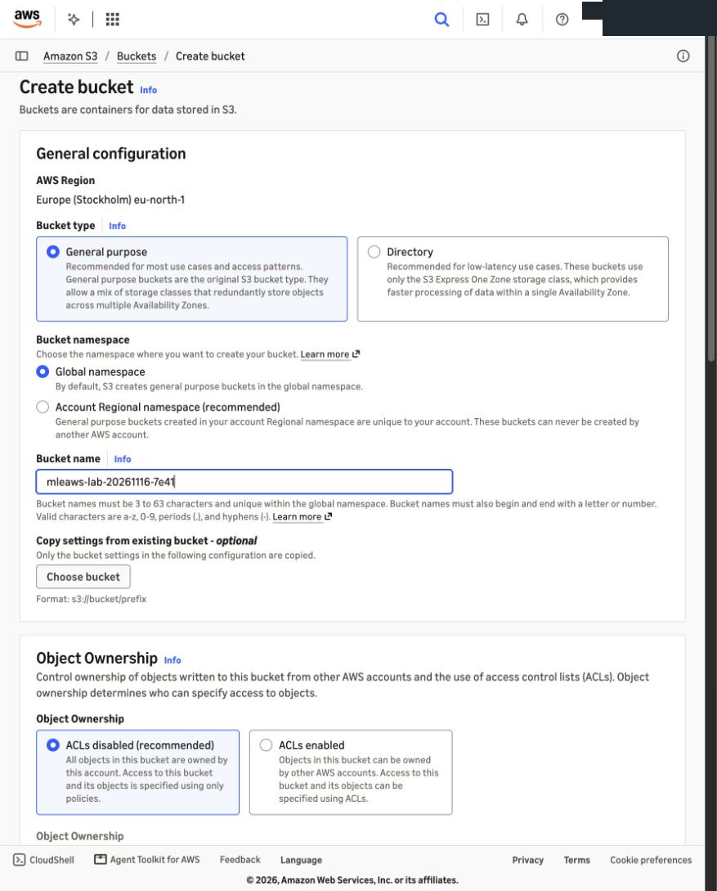
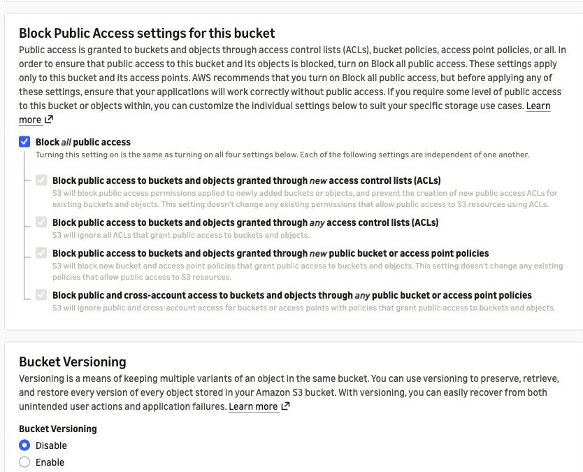
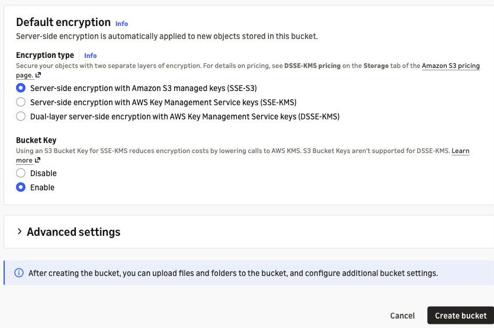
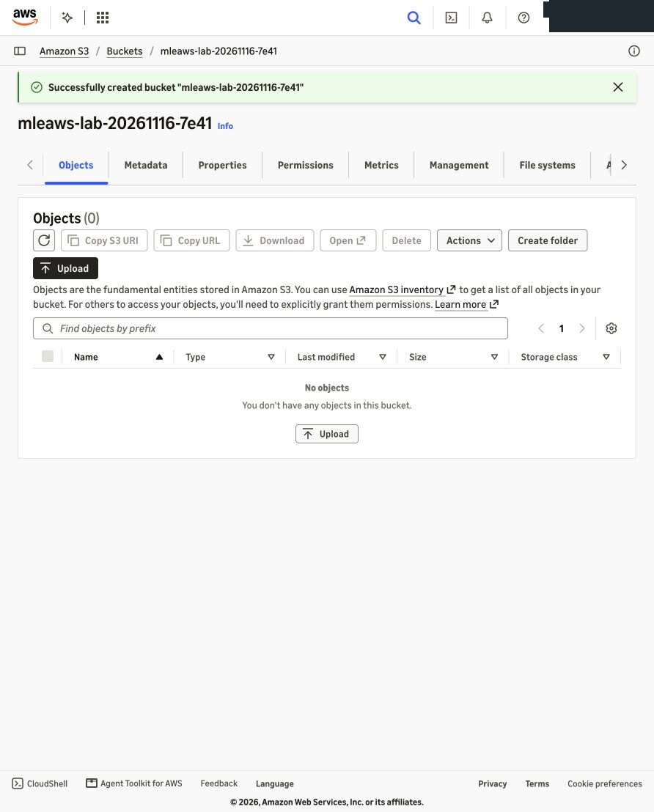
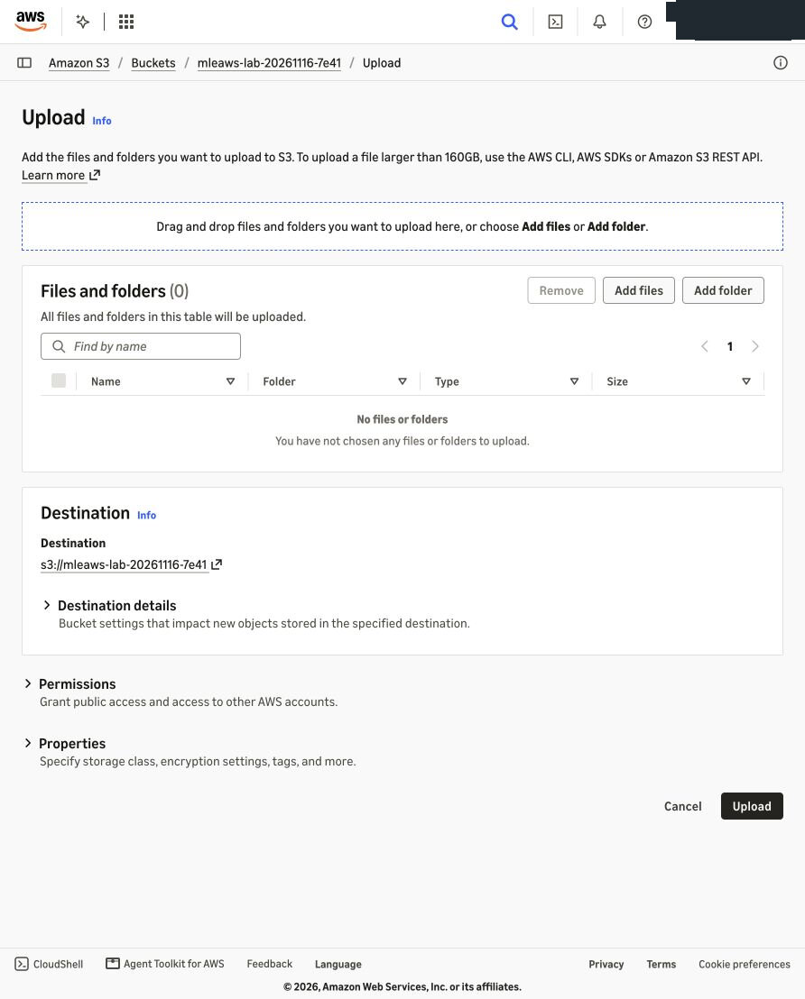
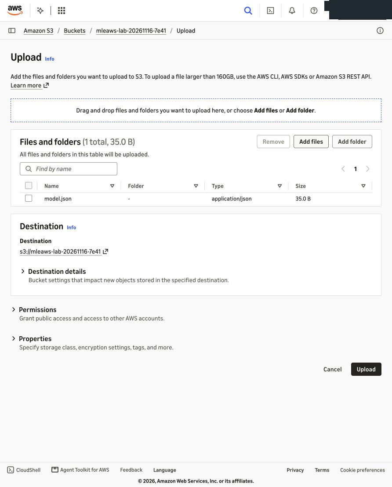
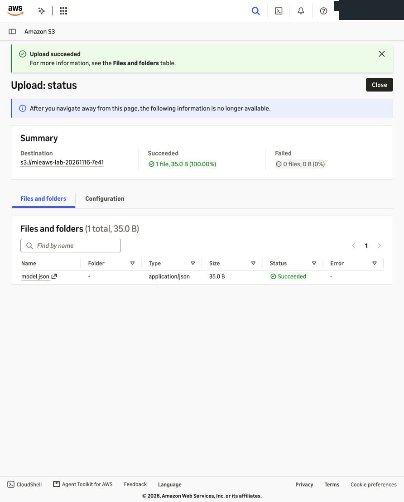

# 02 - Store a Model in S3

**Goal:** Store a model artifact in a private bucket. Amazon S3 is object
storage: a **bucket** holds files as **objects**, each identified by a
**key** (its name or path in the bucket). Here the key is `model.json`, which
holds two numbers for the synthetic model `y = 2x + 1`. S3 stores the
artifact; it does not train the model or run predictions.

## 1. Create a Private Bucket

1. In your project's AWS Console, choose **S3** on Console Home or search
   for **S3**. Open **Buckets → General purpose buckets → Create bucket**.

   

2. Check **AWS Region** against your project's Region. Choose **General
   purpose** and **Global namespace** if the namespace choice appears. In
   **Bucket name**, enter a unique lowercase name such as
   `mleaws-lab-<random-suffix>` (replace the entire placeholder, including
   brackets). Do not use your real name, student ID, or email. If AWS says
   the name is taken, choose another suffix. Record the exact name.

   

3. Keep **ACLs disabled** and **Block all public access** checked. Keep bucket
   versioning disabled for this disposable lab, and leave default encryption
   at **SSE-S3**. Do not change account-level public access settings.

4. At the bottom, choose **Create bucket**. You should see a success message
   and an empty **Objects** tab, or a list with a link to your bucket.

   

   
Show the private settings and creation result

   

   

   

   

## 2. Upload and Verify the Artifact

1. From your bucket's **Objects** tab, choose **Upload → Add files**.
2. Select [model.json](example/model.json) from your downloads. Confirm its
   name is exactly `model.json`, not `model.json.txt`. Upload to the bucket
   root, not a folder, and do not upload your own data.

   
3. Choose **Upload** at the bottom. Wait for **Upload succeeded**. Choose
   **Close** to return to **Objects**. You should see one object.

   

   
Show the staged upload and success result

   

   

   

4. Select the checkbox for `model.json` and choose **Download** if you want
   to verify its contents. Leave it private. An object URL opened without
   authentication is not a supported access path for this lab.

**Checkpoint:** You know your bucket name and the object key is
`model.json`. Next: [03 - Deploy a Prediction Function](03-run-a-prediction-with-lambda.md).
