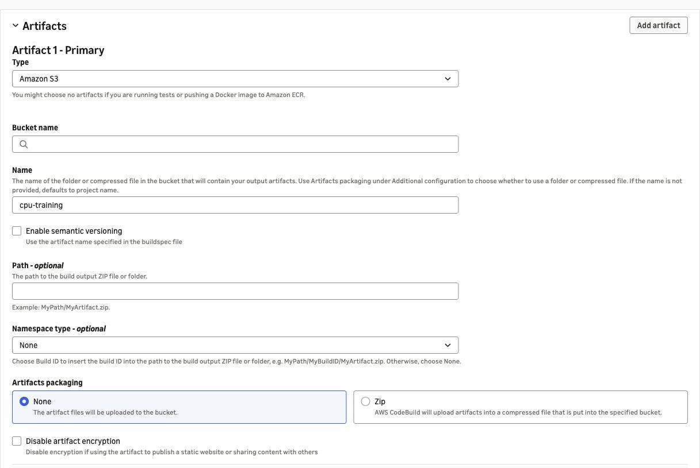
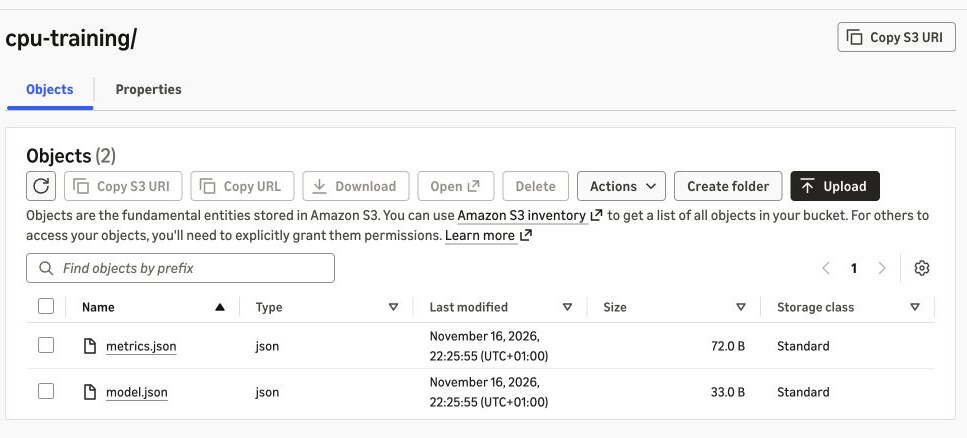
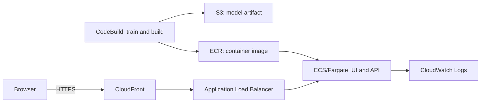
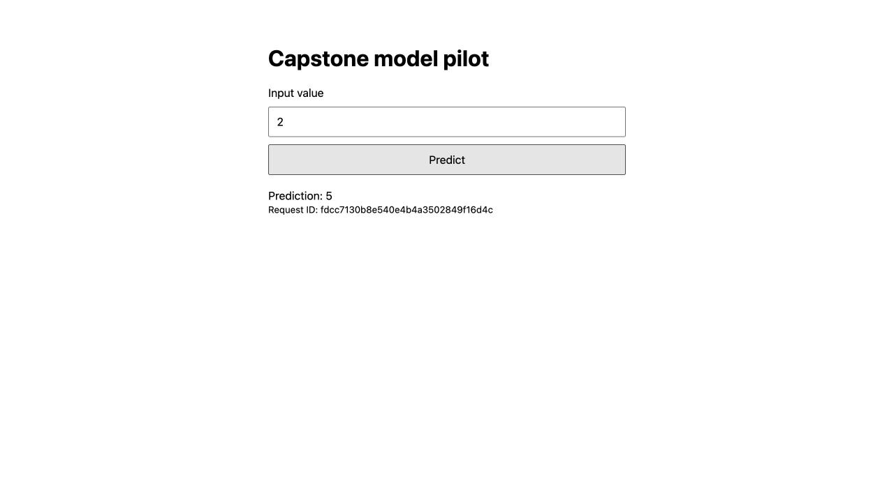
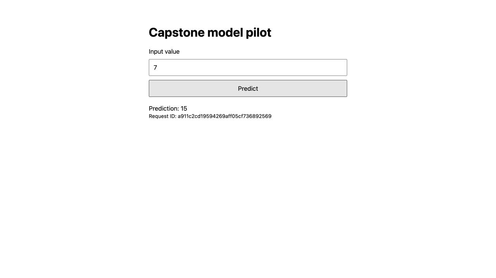

# 05 - Map AWS Services to Your Capstone

**Goal:** Pick the smallest set of services that fits the job. You do not
need to create resources in this chapter. The optional CPU training demo
is run by the instructor; the HTTPS examples are for reading only.

## Start from the Job, Not the Service

| Job | Where it could run or live | When to choose it |
| --- | --- | --- |
| Store datasets, reports, or model artifacts | **S3** | Keep versioned artifacts by object key. S3 is not a database that you query row by row and is not the root disk of a server. |
| Run a short function on demand | **Lambda** | Respond to a request or event without managing a server. An invocation has duration, memory, and packaging limits. |
| Run an existing Docker API | **ECR + ECS/Fargate** | ECR stores the image; ECS schedules and manages tasks; Fargate runs the tasks without you managing EC2 hosts. The task and any load balancer have separate lifecycles. |
| Control a VM, operating system, or long-running process | **EC2 + EBS** | EC2 is the virtual machine. EBS is block storage. You manage more of the stack, and a stopped instance can still have billable disks. |
| Run a bounded CPU training job or build an image | **CodeBuild** | Execute a build script and exit. Save the resulting model to S3 or publish an image to ECR. It does not keep an API running. |
| Expose an HTTP API or serve a web UI | **API Gateway**, or **CloudFront + Application Load Balancer** | API Gateway can expose Lambda or an API backend. CloudFront receives browser traffic at the edge; the load balancer routes requests to the running containers. Neither runs your application. |
| Give services controlled network paths | **VPC** | Use subnets and security groups to decide what is reachable. A public endpoint, a public subnet, and public access to data are different decisions. |
| Query structured application data | **RDS** | Use a managed relational database when you need SQL and transactions. Add it only when an object in S3 is not enough. |
| Control who can call an API or read an object | **IAM** | Define permissions for an identity or workload. In this lab, the role allowed the function to read one private object. |
| Find failures and inspect resource behavior | **CloudWatch** | Start with useful logs and an ID you can trace. Add metrics and alarms when you have a question or a response plan. |

## Examples of Small Architectures

- **Upload and score a single record:** Keep the model in S3, run a Lambda
  on demand, and write a result to CloudWatch. Expose an API only when another
  system needs to call it.
- **Serve a containerized app:** Keep the model in S3, the image in ECR,
  and the API on ECS/Fargate. Add a web entry point only if the project
  needs one. The example below shows how the services fit together.
- **Run a batch training job:** Put inputs and output artifacts in S3,
  execute a bounded job, and terminate the compute when it finishes. A GPU
  is a separate provisioning decision and is outside this lesson.

## Optional Demo: Train on CPU with CodeBuild

**10–15 minutes, instructor-led.** CodeBuild starts a temporary CPU worker,
runs the commands in [buildspec.yml](example/cpu-training/buildspec.yml), and
uploads the output to S3. This demo produces the same model format the
Lambda lab reads, but it fits the coefficients from data instead of starting
with the supplied artifact. No endpoint, GPU, or Docker server is needed.

Prepare before the session: console setup

1. Confirm **Free** and use a dedicated private S3 bucket in the project's
   Region. Select [train.py](example/cpu-training/train.py) and
   [buildspec.yml](example/cpu-training/buildspec.yml) in your file manager,
   compress the two files into `cpu-training-source.zip`, and upload it to
   the bucket. Both files must be at the root of the ZIP, not inside a folder.
2. Open **CodeBuild → Build projects → Create project**. Choose **Default
   project** and give it a unique name such as `mle-cpu-demo-<suffix>`.
   Under **Source**, choose **Amazon S3**, select the private bucket, and set
   **S3 object key or S3 folder** to `cpu-training-source.zip`.
3. In **Environment**, select the managed **Amazon Linux** Standard x86-64
   image `aws/codebuild/amazonlinux-x86_64-standard:6.0` and a new service
   role dedicated to this project. Under **Additional configuration**, use
   **2 vCPUs, 4 GiB**, a **10-minute** timeout, and no retries. Keep
   privileged mode and Docker server off; no custom VPC is needed.
4. Choose **Use a buildspec file** and leave the path blank to use the
   root `buildspec.yml`. Under **Artifacts**, choose **Amazon S3**, select
   the same bucket, enter `cpu-training` for **Name**, and leave **Path**
   blank, **Namespace type** and **Artifacts packaging** at **None**. Keep
   encryption and **CloudWatch logs** enabled, then create the project.

   

If the console denies access or requires an upgrade, stop and use the
script and expected results below. Do not broaden permissions or change plans.

1. **Inputs and job (3 min).** Show the source ZIP in S3 and the
   CodeBuild project. Open `train.py`: it fits a linear regression on 80
   synthetic examples and holds out 20 to check it. Choose **Start build**
   once. While it starts, show how the buildspec separates the training
   command from the files CodeBuild uploads.
2. **Run and inspect (5–7 min).** Open **Build history → Build logs**.
   Look for `cpu_training_complete` and a successful artifact upload.
   In the bucket, open `cpu-training/`: `model.json` contains `slope: 2`
   and `intercept: 1`; `metrics.json` reports `mean_absolute_error: 0.0`
   on the 20 held-out examples. The zero error is expected for these
   noise-free synthetic data, not a claim about real-data performance.
   The required Lambda lab still uses its own copy of `model.json`.

   
3. **Clean up (2–5 min).** Stop any unfinished build and wait for it to
   stop. In **Build history**, select only this run and choose **Delete
   builds**, then delete its CodeBuild project. Delete its
   `/aws/codebuild/<project-name>` log group and dedicated IAM role. In
   **IAM → Policies**, remove only the unattached policies created for
   this project (`CodeBuildBasePolicy-…` and `CodeBuildS3ReadOnlyPolicy-…`).
   Empty and delete the demo bucket, then verify removal. Do not delete a
   learner's bucket. If the demo runs long, show the expected results and
   finish cleanup without extending the lab.

## Example: Serve a Prediction over HTTPS

In a tested AWS Free pilot, the same `y = 2x + 1` model ran in a web app
instead of a Lambda function. Use the diagram and captures to follow one
prediction. You do not need to provision this stack: its resources were
deleted after the test, so the original URL is no longer active.

1. **Build and package:** CodeBuild trains the model on CPU, saves the
   artifact to S3, and pushes a container image to ECR. In an active
   project, inspect **CodeBuild → Build history**, the model object in
   **S3**, and the image in **ECR → Repositories → Images**.
2. **Follow the request:** The browser sends an HTTPS request to CloudFront.
   CloudFront forwards it to the load balancer, which routes it to the
   container running on ECS/Fargate. Check **CloudFront → Distributions**
   for the domain and origin, then **ECS → Clusters → Services → Tasks**
   for the running container. The browser connection used HTTPS; the
   CloudFront-to-load-balancer connection in this pilot used HTTP.
3. **Check the prediction:** The container returns `5` for input `2` and
   `15` for input `7`. It also returns a request ID. In an active project,
   look for that ID in **CloudWatch → Logs → Log Management**, just as you
   did with Lambda in [lesson 04](04-read-logs-in-cloudwatch.md).

Show the two predictions from the HTTPS pilot

**Bonus, read only:** [API Gateway HTTP API → Lambda](https://docs.aws.amazon.com/apigateway/latest/developerguide/getting-started.html)
is a smaller way to give a client an HTTPS endpoint without an ECS service,
load balancer, or CloudFront distribution. An endpoint has its own access
controls and cleanup. Do not create one for this lab.

For your capstone, write down **what you need to store, what needs to run
continuously, and what needs to be public**. For each resource, name its
owner and what you will do with it when the project ends. Then complete
[06 - Clean Up and Check Billing](06-clean-up-and-check-billing.md).
